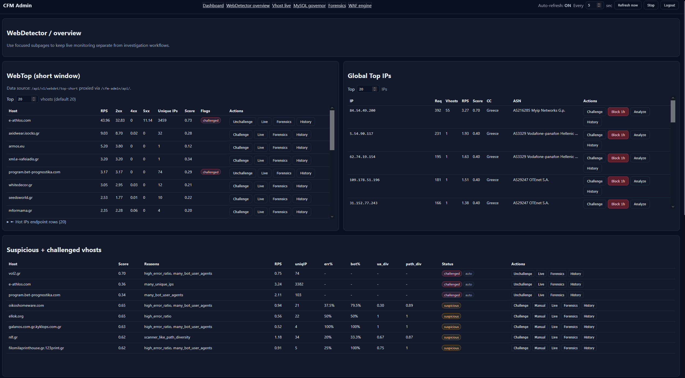
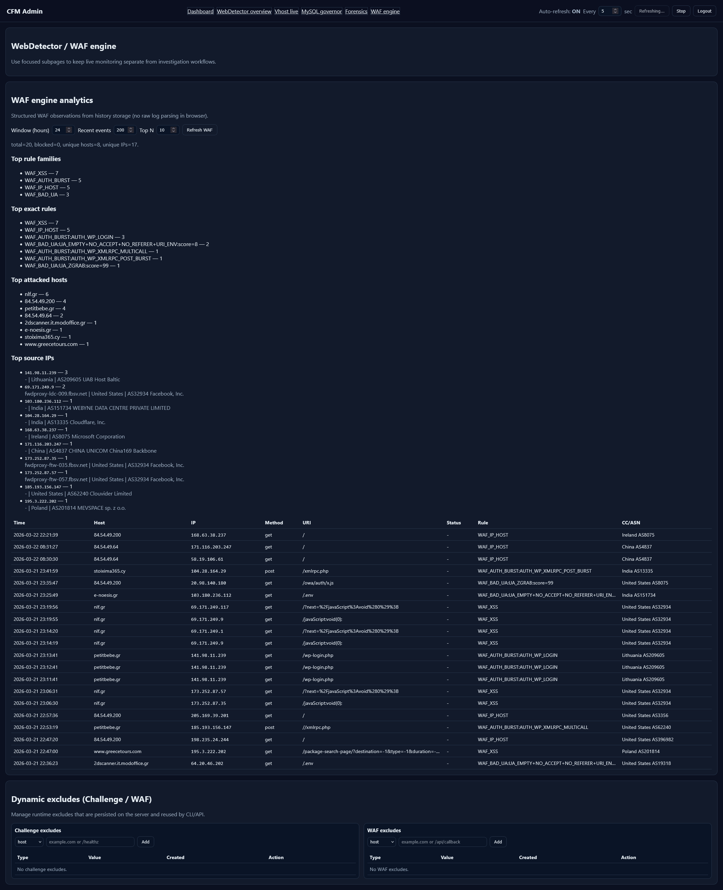
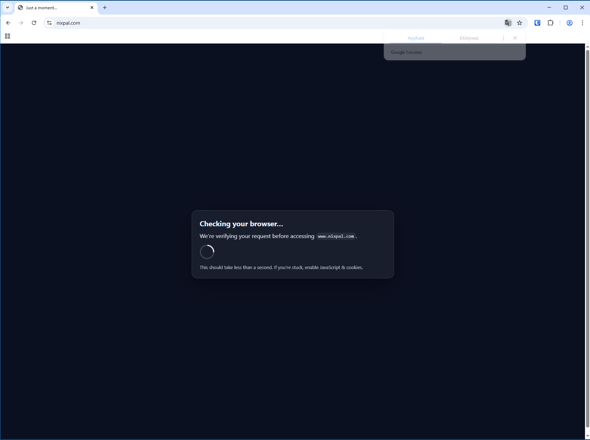
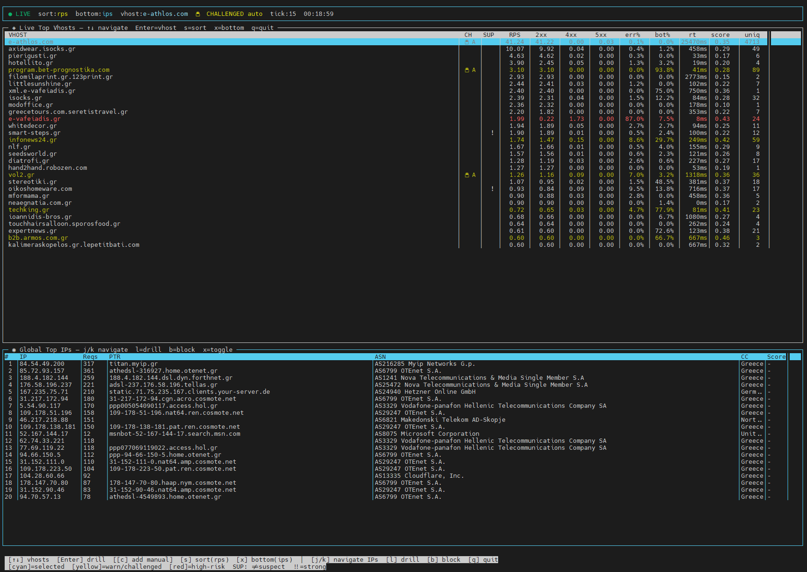

# CFM – Configurable Firewall Manager
<p align="center">
  <b>L3–L7 firewall · WAF · interactive challenge · behavioural BPF LSM detection · KSPP-grade kernel hardening</b><br>
  <i>a single Go daemon, layered defence-in-depth for modern hosting stacks</i>
</p>

<p align="center">
  
</p>

<p align="center">
  
  
  
  
  
  
</p>

CFM is one Go daemon that protects a hosting server from the HTTP edge down
to the kernel: an nftables firewall, log-driven detectors with autoblock, an
in-path WAF and challenge engine on an OpenResty or Angie edge, a BPF LSM that
watches for post-exploit behaviour, and kernel-surface hardening. It is built
for shared hosting (cPanel, DirectAdmin, CloudLinux, plain nginx/Apache) and
runs with no iptables, no kernel module and no agent.

> More: https://infected.gr/category/cfm/ · Where it is going: [`docs/ROADMAP.md`](docs/ROADMAP.md)

---

## Contents

1. [The layers](#1-the-layers)
2. [Install](#2-install)
3. [Configuration files](#3-configuration-files)
4. [Feature tour](#4-feature-tour)
5. [CLI at a glance](#5-cli-at-a-glance)
6. [API, web UI and MCP](#6-api-web-ui-and-mcp)
7. [Security notes](#7-security-notes)
8. [Documentation index](#8-documentation-index)
9. [License](#9-license)

---

## 1. The layers

| Layer | What it does | Doc |
|---|---|---|
| **Challenge engine** | Interactive proof-of-work served in-path by the edge; a solve earns a signed, host- and scope-bound clearance cookie. `challenge_v2` also scores the solve for headless-browser tells | [`docs/traffic-classifier.md`](docs/traffic-classifier.md) |
| **WAF** | Lua rule pipeline in the edge, per-rule modes `disabled / logonly / challenge / challenge_v2 / block`, per-vhost excludes, block hits feed nft autoblock | [`docs/waf.md`](docs/waf.md) |
| **Detectors + web detector** | Log-driven detectors (SSH, mail, FTP, cPanel, MySQL, ModSecurity, CFM's own API, health, web traffic) with per-section block policy and TTL bans | [`docs/DETECTORS.md`](docs/DETECTORS.md) |
| **nftables firewall** | Ports policy, allow/block sets and feeds, connection and rate limits, portscan tracking, edge DNAT | [`docs/cli.md`](docs/cli.md) (`cfm firewall`) |
| **cfm-lsm** | CO-RE BPF LSM programs (no module, no DKMS) catching post-exploit behaviour at the syscall boundary: memfd exec, reverse shells, sensitive-file writes by web users | [`docs/cfm-lsm.md`](docs/cfm-lsm.md) |
| **kernsec** | KSPP-derived sysctls, boot arguments, module blacklists and mount-option audit; tiered, previewed, reversible | [`docs/kernsec.md`](docs/kernsec.md) |

```
        request / login / connection / outbound abuse
                              ↓
  [1] challenge engine   edge, prove you are a browser
  [2] WAF                edge, known attack shapes
  [3] detectors          logs, the campaign across requests and services
  [4] cfm-lsm            kernel hook, the consequence of a successful exploit
  [5] kernsec            boot + runtime, less surface to pivot through
```



---

## 2. Install

### Debian / Ubuntu
```bash
wget -qO - https://repo.nixpal.com/debian/nixpal-repo.gpg | gpg --dearmor -o /etc/apt/trusted.gpg.d/nixpal-repo.gpg
wget https://repo.nixpal.com/debian/nixpal.list -O /etc/apt/sources.list.d/nixpal.list
apt update && apt install cfm
```

### EL (AlmaLinux / Rocky / CloudLinux)
```bash
dnf install https://repo.nixpal.com/el/nixpal.rpm
dnf install cfm
```

Packages create the `cfm` system user and group.

### First login

```bash
cfm auth user add -u <name> -r admin    # password prompted; MFA available
```

Then open `https://<hostname>/cfm-admin/` (through the edge) or
`https://<server>:6061/cfm-admin/` (direct TLS, reachable only from allowed
sources, see [§7](#7-security-notes)). Notifier channels, detectors settings,
WAF, challenges, traffic rules and Site Cache are all managed there.

### The edge proxy

The WAF, challenge and Site Cache need the in-path edge. Install one:

```bash
bash scripts/install-openresty.sh    # the original default
bash scripts/install-angie.sh        # nginx fork tracking mainline; first-class EL10 / Debian 13 packages
```

Both run the same CFM Lua modules (`configs/lua/`, delivered to
`/var/lib/cfm/lua/`) and talk to the same daemon; they can both be installed,
but only one may run (`:9080` / `:9043`). Pick Angie on EL10 / Debian 13 or for
faster nginx CVE fixes; stay on OpenResty if it already works. `cfm dnat on`
then redirects 80/443 to the edge. Design: [`docs/edge-unification-plan.md`](docs/edge-unification-plan.md).

### From source

```bash
groupadd --system cfm
useradd --system --gid cfm --no-create-home --home-dir /var/lib/cfm --shell /sbin/nologin cfm
make build          # ./bin/cfm, CGO_ENABLED=0, BPF objects are pre-built and embedded
```

Only contributors changing BPF C need clang / libbpf (see `docs/cfm-lsm.md`).
Building, tests and the CI gates: [`CLAUDE.md`](CLAUDE.md) §2–§3.

### Firewall engine

`CFM_FIREWALL_ENGINE` in `cfm.conf`: `nft` (default, exec) or `nftlib`
(netlink, no fork for block / allow / feed writes). The daemon and the CLI
read the same line; restart after changing it, and do not set it with
`systemctl set-environment` (the CLI would not see it). The `nft` binary is
still required with `nftlib`: the ports policy and the DNAT accepts are written
as nft text.

---

## 3. Configuration files

Reference copies ship in `configs/` (packaged to `/usr/share/cfm/configs/`);
the live files are in `/etc/cfm/`. Generated runtime state (rendered Lua,
tokens, stores) lives in `/var/lib/cfm/`.

| File | What it holds | Doc |
|---|---|---|
| `cfm.conf` | ports policy, nft priorities, connection limits, API listeners and auth, MaxMind, ClamAV, outbound sentinel, SSLCollector | inline comments |
| `detectors.conf` (+ `detectors.d/*.conf` overlays) | every detector section, `[global]` ignores, `[webdetector]`, `[waf_security]`, per-section `BLOCK` policy | [`docs/DETECTORS.md`](docs/DETECTORS.md) |
| `notify.conf` | notifier channels (sendmail / SMTP / Slack), dedupe, routing | cfm-admin Notifier page |
| `cfm.allow` / `cfm.deny` / `cfm.ignore` / `cfm.dyndns` | static allow / permanent deny / never-block / hostnames resolved into allow | |
| `cfm.blocklists` | external feed pulls into allow / block sets | |
| `cfm.dnat_bypass` / `cfm.dnat_cpanel_bypass` | sources that skip the web / panel DNAT | [`docs/dnat-bypass.md`](docs/dnat-bypass.md) |
| `kernsec.conf` / `lsm.conf` | kernel hardening and BPF LSM policy | kernsec / cfm-lsm docs |
| `cfm_waf_config.lua` (optional) | per-rule WAF mode overrides; the daemon copies it for the edge, then reload the edge | [`docs/waf.md`](docs/waf.md) "Promoting a rule" |
| `openresty.conf` / `angie.conf` | the edge configuration | |

**GeoIP / ASN data.** With `MAXMIND_ACCOUNT_ID` and `MAXMIND_LICENSE_KEY` set,
CFM downloads MaxMind GeoLite2; otherwise IPLocate's open databases, saved under
the same `GeoLite2-ASN.mmdb` / `GeoLite2-City.mmdb` names (IPLocate has no
city). The daemon and the edge both read either schema. Country and ASN feed
detection, rules, policy and reports, so a node without them is half blind.

---

## 4. Feature tour

### Firewall and autoblock
`inet cfm` table, recreated idempotently; allow / block sets (v4/v6) with
TTL or permanent entries; external feeds replaced in one transaction;
`TCP_IN` / `UDP_IN` / `TCP_OUT` / `UDP_OUT` applied as one atomic ruleset;
connection limits, port flood, packet and new-connection rates, ICMP limits,
bad TCP flags, portscan tracking, SMTP_BLOCK. Detectors ban through one sink
(per-section `BLOCK = no | dryrun | permanent | <ttl>`, leniency, dedupe,
reporting). TTL bans survive a reboot or `cfm disable` (`/var/lib/cfm/ttlbans.json`).
Clients behind Cloudflare, whom nft cannot see, are banned at the edge
instead ([`docs/proxied-ipfilter.md`](docs/proxied-ipfilter.md)).
`cfm which <ip>` finds an address in every list.

### Web detector and challenges
The web detector reads every request (from the edge over
`/run/cfm/ingest.sock`, or by tailing a TSV log / a cPanel domlogs folder;
`cfm webtop source` shows which) and keeps short and long windows per vhost
and per IP. It bans floods and scanners, scores suspicious vhosts and can
challenge a whole vhost automatically. Challenges come from: a vhost's score,
a manual `cfm webtop challenge add <vhost>` (with an optional lockdown that
withdraws every crawler exemption), malicious-path hits per IP, traffic rules,
WAF rules at challenge tier, operator fingerprint / country / ASN policy from
cfm-web, and under-attack mode. Verified good bots are let through.
Plan of record: [`docs/abuse-defense-master-plan.md`](docs/abuse-defense-master-plan.md).



### Traffic rules
Per-vhost `block` / `challenge` / `throttle` / `allow` by country, IP / CIDR,
verified bot, User-Agent, path, method and query, with recipes in cfm-admin. [`docs/traffic-rules.md`](docs/traffic-rules.md)

### WAF
About 115 rules with stable ids in groups 1xx–9xx plus a CVE band (10000+):
traversal, bad UA, SQLi, XSS, RCE, PHP wrappers, XXE, Log4Shell, uploads and
webshells, backdoor droppers, auth bursts (wp-login, xmlrpc), protocol
anomalies, SSRF / C2, named CVE exploits. Block-tier hits ban the source
through `waf_security`. Tune with `cfm webtop waf hit-rates`, rule-scoped
excludes and `make waf-corpus`. [`docs/waf.md`](docs/waf.md) ·
[`WAF_CVE.md`](WAF_CVE.md) · [`docs/waf-autoblock-design.md`](docs/waf-autoblock-design.md)

### Site Cache
Per-vhost edge caching, off until a vhost is armed: static assets (Tier A)
and a 1–120 s micro-cache of anonymous pages (Tier B), with absolute rails
for cookies, credentials, panels and webmail.
[`docs/site-cache-runbook.md`](docs/site-cache-runbook.md)

### Panel protection
cPanel / WHM / Webmail / DirectAdmin ports behind the same edge, with the
panel WAF, decision and challenge. [`docs/panel-dnat.md`](docs/panel-dnat.md)

### SSLCollector
Finds certificates on disk (cPanel, DirectAdmin, Plesk, Let's Encrypt, …)
and serves them to the edge over a unix socket for per-SNI loading.
[`docs/ssl-collector.md`](docs/ssl-collector.md)

### ClamAV upload scanning
Uploads through the edge scanned by clamd, notify-only or blocking per vhost
(fail-open). [`docs/clamav.md`](docs/clamav.md)

### Mail
Per-domain traffic, deliverability, queue and DNS checks, and abuse findings
(hacked contact forms, mailbox spikes, hijacked mailboxes).
[`docs/mail-abuse.md`](docs/mail-abuse.md)

### Outbound Abuse Sentinel
Which hosted account is sending spam, scanning or flooding out, with the
script's `cwd` and command line. [`docs/outbound-sentinel.md`](docs/outbound-sentinel.md)

### MySQL Governor
Processlist monitor: slow-query notices, runaway-query kills, per-user
connection limits, sleep reaper, per-user CPU. [`docs/mysql-governor.md`](docs/mysql-governor.md)

### cfm-lsm
Seventeen BPF LSM policies, shipped on in monitor mode; eight can enforce.
Programs pin to bpffs, so protection outlives a daemon restart.
[`docs/cfm-lsm.md`](docs/cfm-lsm.md)

### kernsec
`cfm kernsec status | preview | apply | rollback`, with a drift monitor.
[`docs/kernsec.md`](docs/kernsec.md)

### Alerts, backups, health
Every notification and its delivery outcome ([`docs/alerts.md`](docs/alerts.md)),
JetBackup / Virtualmin / Proxmox backup checks ([`docs/backup-check.md`](docs/backup-check.md)),
edge health checks ([`docs/edge-health.md`](docs/edge-health.md)), and the
`whats_wrong` triage ([`docs/whats-wrong-rootcause.md`](docs/whats-wrong-rootcause.md)).

---

## 5. CLI at a glance

`cfm` with no arguments prints the full usage; most commands take `help`.

| Command | What it does | Doc |
|---|---|---|
| `cfm status` | daemon and firewall state | |
| `cfm test` | host prerequisites (nft / ipset binaries, kernel modules) | |
| `cfm block` / `unblock` / `allow` / `unallow` / `list` / `which` | manage and find addresses | |
| `cfm flush` / `disable` / `reset` | clear bans / tear down nft | |
| `cfm firewall status \| path` | firewall health, host-wide netfilter order | [`docs/cli.md`](docs/cli.md) |
| `cfm dnat …` | web and panel DNAT, bypass lists | [`docs/panel-dnat.md`](docs/panel-dnat.md) |
| `cfm webtop …` | live web traffic, challenges, WAF, rules, Site Cache, history | [`docs/cli.md`](docs/cli.md) |
| `cfm bots …` | box-wide User-Agent throttle / block | [`docs/cli.md`](docs/cli.md) |
| `cfm mysqltop …`, `cfm mailtop`, `cfm lve` | MySQL, mail queue, CloudLinux per-tenant CPU | |
| `cfm health`, `cfm realip`, `cfm debug` | node health, origin real-IP check, diagnostic bundle | [`docs/cli.md`](docs/cli.md) |
| `cfm clam …`, `cfm ssl …` | ClamAV, SSLCollector | |
| `cfm kernsec …`, `cfm lsm …` | kernel hardening, BPF LSM | |
| `cfm auth …` | admin users, sessions, MFA | |



---

## 6. API, web UI and MCP

- **API**: `/api/v1/*` on `127.0.0.1:6060` (plaintext, loopback) and `:6061`
  (TLS), the same handlers the CLI and cfm-admin use. Bearer `AUTH_TOKEN` for
  admin; scoped viewer tokens for cPanel users. Recipes:
  [`docs/webui-api-curl-recipes.md`](docs/webui-api-curl-recipes.md); which
  endpoint a scoped token may call: [`docs/endpoint_scope_inventory.md`](docs/endpoint_scope_inventory.md).
- **cfm-admin**: `/cfm-admin/` through the edge or `:6061`. The cPanel / WHM
  plugin (`plugins/cfm-plugin-cpanel`) embeds it for tenants (scoped) and
  root (admin SSO).
- **MCP**: a read-only MCP server at `/mcp` for Claude and other MCP clients.
  [`MCP.md`](MCP.md)
- How the control plane is protected: [`docs/security/control-plane.md`](docs/security/control-plane.md).

---

## 7. Security notes

- `:6060` binds loopback; `PORT` and `TLS_PORT` are dropped by nft except from
  this host, the `API_URL` host (cfm-web) and the allow lists. Do not open them
  wider. `ADMIN_TOKEN_IP_BINDING = enforce` also binds the admin token to those
  sources at the app layer.
- Keep the challenge listener on loopback (`CHALLENGE_HTTP_LISTEN`,
  `127.0.0.1:9098`).
- The edge's unix sockets (decision bridge, SSLCollector) carry tokens kept in
  `/var/lib/cfm/secrets`; the edge workers must run as the `cfm` user.
- Keep `IGNORE_IPS` / `IGNORE_NETS` narrow: an ignored address skips the WAF and
  every challenge. Never add a source whose target URL anyone can choose
  (uptime checkers, webhooks) to a bypass.
- The MySQL governor's `alter_user` action needs `CREATE USER`: grant it to
  `'cfm_governor'@'localhost'` only, and run the governor in `monitor` mode
  for a week before `enforce`.

---

## 8. Documentation index

[`CLAUDE.md`](CLAUDE.md) §7 lists every doc by topic, and §6 the areas where
changes have historically gone wrong. Release history: [`CHANGELOG.md`](CHANGELOG.md).

---

## 9. License

CFM is **source-available** under the [Functional Source License, Version 1.1,
ALv2 Future License](LICENSE) (FSL-1.1-ALv2). Each version becomes **Apache
2.0** two years after its release. The BPF programs under
`internal/lsm/bpf/` are GPL-2.0-only, as the kernel requires. Details and the
exceptions: [`NOTICE`](NOTICE).

What the license allows, in short (the [`LICENSE`](LICENSE) text decides):

- **Allowed, free of charge:** running CFM on your own servers, including to
  protect the sites and mail of your hosting customers; changing it for your
  own use; education and research; installing and running it for a client
  who uses it under these terms.
- **Not allowed without a commercial license:** offering CFM, or a product or
  service built on it, to others as a commercial firewall / WAF / server
  security product or service that substitutes for it (a "Competing Use").
  Commercial licensing: chrismfz [at] gmail [dot] com.

Versions released before 2026-11-18 were licensed under Apache 2.0 and remain
so.
