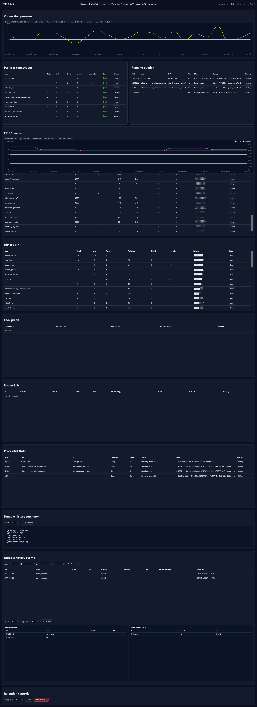
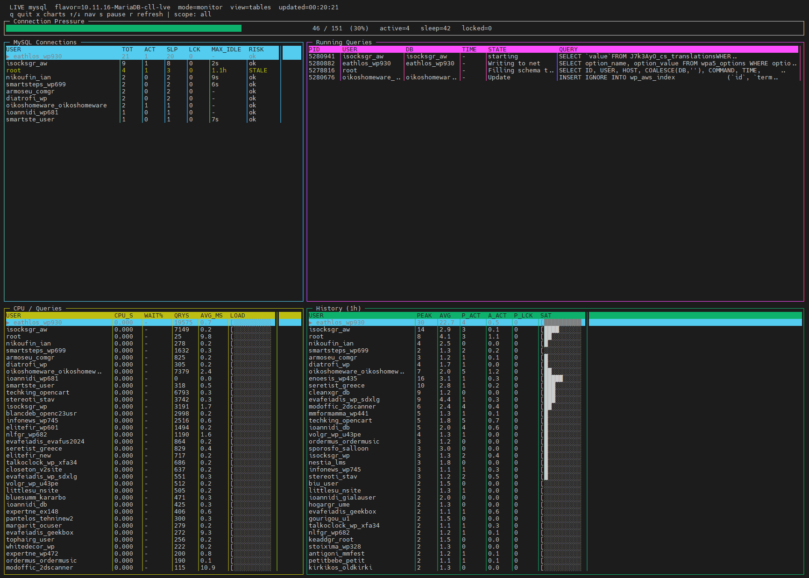
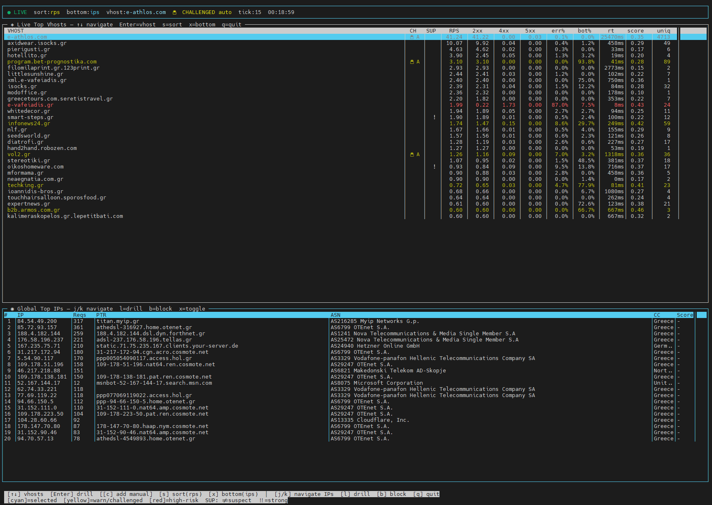

# MySQL Governor

The MySQL Governor is a processlist monitor and enforcement engine that runs inside cfm. It polls `information_schema.PROCESSLIST` every few seconds and can: notify on slow queries, kill runaway queries, enforce per-user connection caps, reap idle sleeping connections, and track per-user CPU usage.

It operates entirely through a standard MySQL connection — no agent, no plugin, no kernel module required.

## 🧠 Visual Overview




## Overview

Two complementary detectors cover MySQL:

| Section | What it does |
|---|---|
| `[mysql]` | Reads the **error log** for failed auth attempts. Blocks brute-force IPs via nft. No DB connection needed. |
| `[mysql_governor]` | Connects to MySQL live. Monitors the **processlist** every poll tick. Kills runaway queries and enforces connection limits. |

## MySQL Grants

The governor needs a dedicated account. Create it once:

```sql
-- Both MariaDB and MySQL 5.7+
CREATE USER 'cfm_governor'@'localhost' IDENTIFIED BY 'strongpassword';
GRANT PROCESS ON *.* TO 'cfm_governor'@'localhost';

-- MySQL 8.0+ also needs:
GRANT CONNECTION_ADMIN ON *.* TO 'cfm_governor'@'localhost';

-- For CONN_RULES alter_user action (dynamic connection caps):
GRANT CREATE USER ON *.* TO 'cfm_governor'@'localhost';
```

Credentials are auto-detected in this order:
1. `DSN =` in `detectors.conf` (explicit override)
2. `/root/.my.cnf` (standard cPanel / server root)
3. `/etc/cfm/mysql_governor.cnf`
4. `/usr/local/directadmin/conf/mysql.conf` (DirectAdmin)

The governor connects in the background, so a slow or absent database never
holds up the daemon. If MySQL is not reachable yet (`cfm.service`
deliberately has no ordering on `mariadb`/`mysqld`, since many nodes run no
database), it keeps retrying: every 5 s doubling to every 5 min while
credentials exist but the connect fails, every 5 min (a file check, no
connection) while no credentials exist at all. `ENABLED = 0` in
`[mysql_governor]` (on every instance, if there are several) keeps it from
starting: no connection is made, and the 5-minute check only re-reads the
config, so re-enabling it there starts it within 5 minutes, without a restart
(disabling a running governor still needs one). A `detectors.conf` that
cannot be read on first load holds it the same way, re-checked every 5 s, so
it starts within seconds of the file reading; removing the file while the
daemon runs leaves the last setting in place. Until it runs,
`/api/v1/mysql/*` answers "mysql governor not running: <state>" with the full
reason and a `Retry-After` of the next attempt; scoped (cPanel user) callers
get only "mysql governor not running". The states:

| State | Meaning | MCP `whats_wrong` |
|---|---|---|
| `starting` | first attempt still under way (just after a daemon start) | unavailable |
| `no credentials` | no credential source found: a node without a database | unavailable |
| `disabled` | `ENABLED = 0` | unavailable |
| `held` | `detectors.conf` unreadable on first load | error |
| `connect failed` | credentials found, connect failed (MySQL down, wrong password) | error |
| `failed` | connected, but the governor failed to initialise | error |

`cfm mysqltop` prints the reason. `/var/log/cfm/cfm.mysql.log` logs each change
of state and the eventual start.

## Operating Modes

```ini
MODE = monitor   # observe and log "WOULD_KILL …" — never issues actual kills (safe default)
MODE = enforce   # live kills + ALTER USER
```

Start in `monitor` mode for at least a week. Review `cfm mysqltop kills` and `/var/log/cfm/cfm.mysql.log` to validate that the rules match your expectations before switching to `enforce`.

The following users are **always exempt** regardless of rules — they can never be killed:
`root`, `cpanel`, `cpanelroundcube`, `cpaneleximscanner`, `da_admin`, `debian-sys-maint`,
`proxysql_monitor`, `mysql.sys`, `mysql.session`, `mariadb.sys`, `event_scheduler`.

## Dedicated Log Channel

All governor activity is written to a separate log file, independent of the main cfm log:

```ini
# In cfm.conf:
MYSQL_LOG_STDOUT = 0
MYSQL_LOG_FILE   = /var/log/cfm/cfm.mysql.log
```

If `MYSQL_LOG_FILE` is not set, log lines are auto-derived from the main `LOG_FILE` path (e.g. `/var/log/cfm/cfm.log` → `/var/log/cfm/cfm.mysql.log`).

Example log output (enforce mode):
```
2026-03-05 17:15:29 [mysql/governor] KILL QUERY pid=3321367 user=mathemat_db db=mathemat_mkportal runtime=90s reason="rule: kill_query runtime=90s" unblocked=315 result=OK
2026-03-05 17:15:30 [mysql/conn_limit] REAP_SLEEP pid=3344003 user=mediains_db idle=2129s excess=12 result=OK
2026-03-05 17:20:01 [mysql/conn_limit] ALTER_USER user=mathemat_db MAX_USER_CONNECTIONS=80 applied
```

## Connection Pressure

The governor tracks global connection usage as a percentage of `@@max_connections` and fires alerts at two thresholds:

```ini
CONN_WARN_PCT = 70   # notify at 70% of max_connections
CONN_ACT_PCT  = 85   # act (sleep reaper, dynamic CONN_RULES) at 85%
```

Alerts are rate-limited to once per 5 minutes per severity level to avoid notification storms during sustained pressure events.

## Lock Fan-out Kill

The lock fan-out rule is an independent safety net that fires regardless of `QUERY_RULES`. When a single query is blocking `>= N` other queries and has been running for at least `TTL`, it is killed immediately:

```ini
LOCK_FANOUT_KILL = 20   # kill blocker when it holds >= 20 waiters
LOCK_FANOUT_TTL  = 60s  # must have been running for >= 60s first
```

This rule exists specifically to prevent table-lock cascade incidents (the kind where a single phpBB full-text search query holds 315 connections hostage until the server requires a manual MySQL restart).

## Query Rules — QUERY_RULES

`QUERY_RULES` is a multiline block evaluated per running query every poll tick. Rules are evaluated top-to-bottom; the first match for a given query wins.

```ini
QUERY_RULES =
    <user_pattern> : <max_runtime> : <action> [: condition]
```

| Field | Values |
|---|---|
| `user_pattern` | Exact username, `prefix*`, `*suffix`, `*contains*`, or `*` for everyone |
| `max_runtime` | Duration (`30s`, `5m`, `1h`) or `0` to never touch this user (`ignore`) |
| `action` | `notify` \| `kill_query` \| `kill_connection` \| `ignore` |
| `condition` | `lock_fanout=N` — only fire if blocking >= N others |
| | `conn_pct=N` — only fire if global connections >= N% |

**Pattern matching:**
- `mathemat_db` — exact match
- `mediains_*` — matches any user starting with `mediains_`
- `*_wp*` — matches any user containing `_wp` (e.g. `happykids_wp861`)
- `*_mage*` — matches any user containing `_mage`
- `*` — matches everyone (use last, as the catch-all)

**Actions:**
- `notify` — enqueues a `MYSQL/GOVERNOR warn` alert. Does not kill.
- `kill_query` — issues `KILL QUERY id`. The statement dies but the connection stays open. The application sees an error and can retry.
- `kill_connection` — issues `KILL id`. The connection is dropped entirely. Use for connection-leak users.
- `ignore` — hard exemption. Used with `max_runtime=0` to protect long-running cron/import jobs.


## Connection Limit Rules — CONN_RULES


| Field | Values |
|---|---|
| `user_pattern` | Same wildcard rules as `QUERY_RULES` |
| `max=N` | Total connection cap (sleeping + active + locked) |
| `action` | `notify` \| `reap_sleep` \| `alter_user` |
| `conn_pct=N` | Optional: only enforce when global connections >= N% (dynamic cap). Omit for always-active (static). |

**Actions:**

`notify` — alert only. No kills. Use to observe baselines before enforcing.

`reap_sleep` — when a user exceeds their cap, kill their oldest sleeping connections (by idle time) until back under the limit. The InnoDB open-transaction guard is always applied: a sleeping connection with an open transaction is never killed.

`alter_user` — issues `ALTER USER 'x'@'%' WITH MAX_USER_CONNECTIONS N` so MariaDB itself refuses new connections beyond the cap at the protocol level. Also falls through to `reap_sleep` to clean up existing sleeping connections already over the cap. Reversed automatically (set back to 0) when the user drops back under their limit. Requires `GRANT CREATE USER` on the `cfm_governor` account.

**Static vs dynamic caps:**

A rule without `conn_pct` is always active. A rule with `conn_pct=70` only activates when the server reaches 70% of `max_connections` and deactivates when it drops back below. Dynamic caps are useful as pressure-release valves without constantly restricting tenants during normal operation.

**Example CONN_RULES for shared hosting:**
```ini
CONN_RULES =
    mathemat_db : max=80  : alter_user              ; hard cap via MariaDB itself
    mediains_*  : max=40  : reap_sleep              ; reap sleepers over limit
    *_mage*     : max=60  : notify                  ; observe Magento first
    *_wp*       : max=30  : notify                  ; observe WordPress first
    *           : max=25  : reap_sleep : conn_pct=70 ; dynamic valve under pressure
```

## Sleep Reaper

The sleep reaper is a global sweep separate from `CONN_RULES`. It kills sleeping connections older than `SLEEP_REAPER_AGE` across all users when global connections exceed `CONN_ACT_PCT`. The InnoDB open-transaction guard is always applied.

```ini
SLEEP_REAPER        = 1
SLEEP_REAPER_AGE    = 180s
SLEEP_REAPER_EXEMPT = proxysql_monitor, root
```

The sleep reaper only activates in `enforce` mode and only when connection pressure exceeds `CONN_ACT_PCT`. It is a last-resort mechanism for connection-pool leaks (WP plugins, PHP without persistent connection cleanup, Magento reindexers). For targeted cleanup, use `CONN_RULES reap_sleep` instead.

## Kill Rate Limiting

A hard rate limit prevents a misconfigured rule from wiping out a tenant's entire connection pool:

```ini
KILL_PER_DB_PER_WINDOW = 8    # max kills for a single DB user in the window
KILL_TOTAL_PER_WINDOW  = 30   # max kills across all users in the window
KILL_WINDOW            = 10m  # rolling window duration
```

This limit applies to both `QUERY_RULES` kills and `CONN_RULES reap_sleep` kills. When the limit is reached, the governor logs a rate-limit warning and skips further kills until the window expires.

## CPU and Performance Tracking

The governor tracks per-user CPU and query statistics from `performance_schema` (MySQL 8+) or `information_schema.USER_STATISTICS` (MariaDB with `userstat=ON`). Three paths are supported:

| Path | Database | Requirements |
|---|---|---|
| A | MySQL 8+ | `performance_schema=ON` + statement instruments enabled |
| B | MariaDB | `performance_schema=ON` + `userstat=ON` |
| C | MariaDB fallback | `performance_schema=ON`, `userstat=OFF` (query count only, no CPU) |

The governor auto-detects which path is available at startup and retries every 5 minutes after a MySQL restart.

**To enable CPU tracking on MariaDB (Path B):**
```sql
SET GLOBAL userstat = ON;
-- Make permanent in /etc/my.cnf: userstat = ON
```

**To enable CPU tracking on MySQL 8+ (Path A):**
```sql
UPDATE performance_schema.setup_instruments SET ENABLED='YES', TIMED='YES' WHERE NAME LIKE 'statement/%';
UPDATE performance_schema.setup_consumers  SET ENABLED='YES'               WHERE NAME LIKE 'events_statements%';
```

CPU data is visible via `cfm mysqltop cpu` and the `/api/v1/mysql/cpu` endpoint.

## CLI Reference — cfm mysqltop

## 🖥️ Terminal UI




```bash
cfm mysqltop                        # live summary: connections, per-user table, lock graph, recent kills
cfm mysqltop top [N]                # top N users by connection count (live)
cfm mysqltop locks                  # lock graph — blockers and their waiters
cfm mysqltop kills                  # recent governor kill/reap actions (last 100)
cfm mysqltop ps                     # full processlist as JSON (running + waiting)
cfm mysqltop history [window] [N]   # busiest N users over a historical window
                                    #   window: 30m, 1h (default), 6h, 24h
cfm mysqltop cpu                    # per-user CPU-seconds and query counts
                                    #   shows how to enable tracking if not yet active
cfm mysqltop help                   # usage summary
```


**`cfm mysqltop` (default view) shows:**
- Server flavor + mode (monitor/enforce)
- Connection summary: total/max/pct, active/sleeping/locked with risk icons (🟢🟡🔴)
- Per-user table: connections, active, sleeping, locked, max idle age, risk
- Lock graph: each blocker with waiter count and query preview
- Running queries: top 10 by runtime with lock indicator
- Governor actions: recent kills with PID, user, DB, runtime, reason, result

**`cfm mysqltop history 6h 10`** — peak and average connections per user over the last 6 hours. Useful for identifying which tenants consistently hold many connections versus one-off spikes.

**`cfm mysqltop cpu`** — per-poll CPU-seconds and query counts. If CPU tracking is not yet active, prints the exact SQL or `my.cnf` change needed to enable it.

## HTTP API

On the daemon's API (`:6060` loopback, `:6061` TLS; see
`docs/security/control-plane.md`). Admin only unless marked scoped.

| Endpoint | Description |
|---|---|
| `GET /api/v1/mysql/state` | Full `GovernorState` snapshot |
| `GET /api/v1/mysql/processlist` | Running queries + per-user connection summary |
| `GET /api/v1/mysql/top` | Per-user connection counts + server flavor/mode |
| `GET /api/v1/mysql/locks` | Lock graph (blockers → waiters) |
| `GET /api/v1/mysql/kills` | Recent kill records (last 100) |
| `GET /api/v1/mysql/history?window=1h&top=20` | Historical per-user aggregates |
| `GET /api/v1/mysql/history/{events,summary,timeline}` | History store reads |
| `POST /api/v1/mysql/history/{prune,truncate}` | History maintenance |
| `GET /api/v1/mysql/cpu` | Per-user CPU/query deltas + perf_schema status flags |
| `GET /api/v1/mysql/user-{summary,kills,history}` | **Scoped**: filtered to the caller's own users/databases |
| `POST /api/v1/mysql/user-kill?id=<pid>` | **Scoped**: kill one connection; a scoped caller only within its own (user, db) |

Scope rules: `docs/endpoint_scope_inventory.md`.
